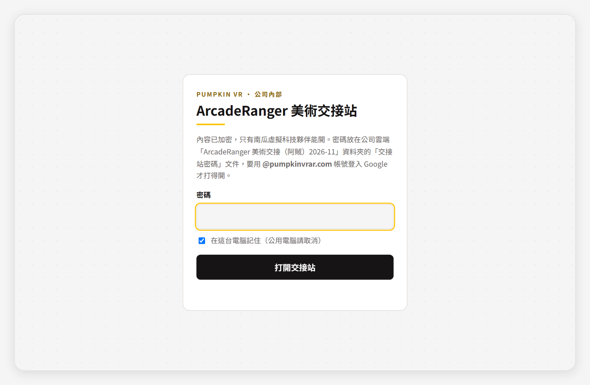
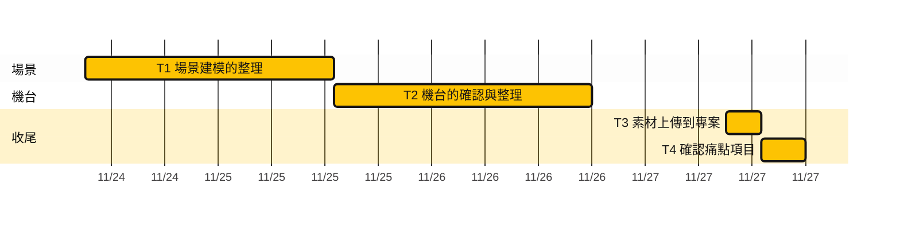
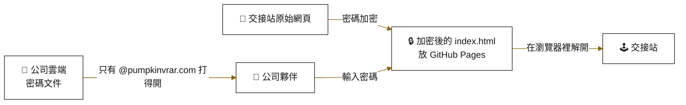

<picture>
  <source media="(prefers-color-scheme: dark)" srcset="assets/banner-dark.svg">
  
</picture>

<h1 align="center">🕹️ ArcadeRanger 美術交接站</h1>

<p align="center"><b>南瓜虛擬科技內部用的美術交接網站：打開就知道今天做什麼、什麼時候交什麼、有問題去哪問</b></p>

<p align="center">
  <a href="https://nanhong-byte.github.io/arcade-ranger-handoff/"></a>
  
  
  
</p>

<p align="center">
  <a href="#-怎麼打開">怎麼打開</a> •
  <a href="#-四天時程">四天時程</a> •
  <a href="#-網站裡有什麼">網站裡有什麼</a> •
  <a href="#-群組回報格式">回報格式</a> •
  <a href="#-為什麼要密碼">為什麼要密碼</a> •
  <a href="#-怎麼更新">怎麼更新</a>
</p>

這是 Arcade Ranger 重製版的**美術交接站**。之前的美術由 Claude、GPT 和南瓜分頭做，成果散在好幾個地方；現在交給一位技術美術夥伴，用四天逐件確認、整理、放進專案。
網站把「現在該做什麼、交什麼、檔案在哪、有問題問誰」整理在同一頁。
網頁放在 GitHub Pages，**內容整個加密**，只有拿得到公司雲端密碼文件的人才打得開。

> [!IMPORTANT]
> 這個 repo 是公開的，但裡面只有加密後的網頁。人名、內部路徑、雲端連結和未公開的美術圖都在加密內容裡，不輸入密碼看不到。

---

## 🚪 怎麼打開

<p align="center"></p>

1. 打開 **https://nanhong-byte.github.io/arcade-ranger-handoff/**
2. 用 `@pumpkinvrar.com` 帳號登入 Google，到公司雲端「ArcadeRanger 美術交接（阿賊）2026-11」資料夾，打開「交接站密碼（ArcadeRanger）」文件拿密碼。
3. 貼上密碼，按「打開交接站」。

**預期結果**：看到十一個分頁的交接站，最上面一個黃框寫著「現在該做」。勾著「在這台電腦記住」，下次打開就直接進去。

> [!TIP]
> 密碼不對會顯示「密碼不對，請再確認一次」。公用電腦記得取消「記住」。

### 兩個版本差在哪

同一份內容有兩個入口。平常看進度用哪個都可以，**要勾選共用進度、用提問板就用 claude.ai 版**。

| | GitHub 版（這裡） | claude.ai 版 |
|---|---|---|
| 怎麼進 | 網址＋密碼 | 南瓜從 Share 選單開給你 |
| 勾選進度 | 只存在自己的電腦 | 所有人看到同一份 |
| 提問板 | 不能用，問題貼群組 | 可以發問、回覆 |
| 適合 | 手機快速看、轉給剛加入的夥伴 | 接手的人每天用 |

claude.ai 版網址也寫在密碼文件裡。

---

## 📅 四天時程

開工日預設 **2026-11-24（二）**，半天一格，週末自動跳過。

| 工作 | 天數 | 時間 | 交付 |
|---|---|---|---|
| **T1** 場景建模的整理 | 1.5 天 | 11/24 → 11/25 上午 | 《場景整理表》＋六區截圖＋Draw call 量測與推論 |
| **T2** 機台的確認與整理 | 1.5 天 | 11/25 下午 → 11/26 | 《機台總表》＋《10 款素材包機台盤點表》 |
| **T3** 整理好素材上傳到專案 | 0.5 天 | 11/27 上午 | 專案裡的素材資料夾＋上傳清單 |
| **T4** 確認痛點項目 | 0.5 天 | 11/27 下午 | 痛點逐條確認＋不確定清單 |



**這四天不包含**：戴頭盔實測、修改已鎖定的機台 UV、做新模型。遇到要修的東西先記下來，不直接改。

---

## 🗂️ 網站裡有什麼

| 分頁 | 內容 | 什麼時候看 |
|---|---|---|
| ① 從這裡開始 | 「現在該做」黃框、開工前準備、三個待確認問題、四天時程、可勾選的小步驟和交付規格 | 每天上班第一眼 |
| ② 美術總覽 | 七大類工項的完成、製作中、卡住、要決定數量，加已完成清單 | 想知道整體進度 |
| ③ 機台 | 8 張機台卡片：縮圖、狀態、已完成、還沒解決、檔案在哪 | T2 |
| ④ 空間 | 街機廳平面圖、六區表（大小、材質、Draw call）、施工階段、外殼貼圖 | T1 |
| ⑤ 痛點 | 9 條玩家痛點，美術怎麼解、現在狀態、請你確認什麼 | T4 |
| ⑥ 尚未製作 | 尚未開始、卡住（在等誰）、要南瓜決定三組 | 排下一步 |
| ⑦ 提問板 | 發問、看回覆（claude.ai 版才能用） | 每天 |
| ⑧ 群組回報 | 日報、交付、卡住三種範本，一鍵複製 | 每天下班前 |
| ⑨ 檔案在哪 | 雲端 7 組壓縮檔各裝什麼、哪天用 | 開工第一天 |
| ⑩ 名詞表 | A10、K102、LOD、UCX、ISM、Draw call 這些縮寫 | 看不懂的時候 |
| ⑪ 角色・武器・道具 | 夾娃娃怪（16 段動畫）、彈簧拳槍、扭蛋飛彈、打地鼠機、兌幣機：改前改後規格、審查結果、原遊戲參考、展示影片 | T2 第 7 步 |

<details>
<summary><b>每一項工作的小步驟（點開看）</b></summary>

**T1 場景建模的整理**

1. 開工前準備＋讀場地四份文件，約 3 小時含下載解壓。
2. 開灰盒地圖，六區各截一張，跟平面圖對照走不走得通、尺寸對不對。
3. 用檢查腳本複驗 8 組外殼貼圖的無縫接縫和鋪貼尺度。
4. **限時 3 小時**：量主遊戲區 Draw call 超標的原因，交量測和推論，不用修好。
5. 交《場景整理表》。

**T2 機台的確認與整理**

1. 讀機台模板規格書和美術進度總表。
2. 用 Blender 跑複驗腳本，數字要跟各資料夾的驗收報告對得上。
7. 看 ⑪ 的敵人和武器第二版：對面數、骨數、材質，看影片和動作拼圖，記下問題（約 2 小時，不用修）。
3. 核對 UV 鎖定檔的檔案指紋。
4. 盤點場地 10 款素材包機台的零件尺寸和圖集空位。
5. 選做：把一台匯進 UE 5.8，看 mip 接縫和 LOD 切換。
6. 交《機台總表》。

**T3 整理好素材上傳到專案**：只放現行版，照規格書命名，附上傳清單。

**T4 確認痛點項目**：痛點逐條看，不確定的事一條一題寫進提問板，發收尾日報。

</details>

---

## 📣 群組回報格式

回報發在 Telegram「ArcadeRanger」群組。每天晚上整理團隊進度的 AI 會把群組訊息讀進團隊進度表，**它只認固定格式**：

- 第一行：`#AR美術日報`／`#AR美術交付`／`#AR美術卡住`／`#AR美術提問`＋日期＋名字
- 第二行：`ArcadeRanger: 工作內容`，冒號後寫中文項目名稱

```text
#AR美術日報 11/24 阿賊
ArcadeRanger: 場景建模的整理（第 1／1.5 天）
✅ 完成：讀完場地文件；8 組外殼貼圖檢查全過
🟡 進行中：主遊戲區 Draw call 超標原因
⛔ 卡住：灰盒地圖在哪個專案還沒拿到（等南瓜）
❓ 提問：提問板 2 題
📅 明天：上午交場景整理表，下午開始機台確認
```

<details>
<summary><b>交付、卡住的範本和完整規則</b></summary>

```text
#AR美術交付 11/25 阿賊
ArcadeRanger: 場景整理表
📎 連結：
📝 重點（三行內）：
❓ 要南瓜決定：
```

```text
#AR美術卡住 11/25 阿賊
ArcadeRanger: 機台的確認與整理
卡在：
已經試過：
需要誰：南瓜／程式夥伴
```

1. 每天下班前一則日報，沒進度也發；日報可以列好幾項。
2. 交付、卡住、提問一則只講一件事；交付要附連結。
3. 在提問板問過的不用另外發群組，日報寫題數就好。
4. 寫「完成」前先確認真的做完。
5. 不要貼金鑰、IP、密碼、報價。

</details>

---

## 🔐 為什麼要密碼

GitHub 免費方案的 Pages 網站一律公開，沒辦法設定「只有公司信箱能看」。所以這裡的做法是：



- 網頁用 **AES-256-GCM** 加密，金鑰由密碼經 **PBKDF2（60 萬次 SHA-256）** 算出來。解密在瀏覽器裡做，伺服器上只有密文。
- 密碼放在只開給 `pumpkinvrar.com` 網域的 Google 文件，等於「有公司帳號才拿得到密碼」。

> [!WARNING]
> 密碼外流的話，拿到密碼的人就打得開。發現外流就請 Claude 換密碼重新打包，並更新密碼文件；舊密碼會立刻失效。

---

## 🔧 怎麼更新

網站正本是另一份未加密的 `index.html`（放在南瓜的開發電腦，不在這個 repo）。改完正本後：

```bash
HANDOFF_PW="<密碼文件裡的密碼>" node tools/build.js "<正本資料夾>" index.html
```

**預期結果**：印出 `ok 1339 KB 24 張圖` 這類訊息，`index.html` 換成新的加密版。commit、push 後約 1 分鐘 Pages 更新。

| 檔案 | 用途 |
|---|---|
| `index.html` | 加密後的交接站（Pages 首頁） |
| `tools/build.js` | 把正本和 24 張縮圖打包成單檔，再加密 |
| `tools/gate.html` | 密碼頁的樣板 |
| `assets/` | 這篇文章用的 Banner 和截圖 |

<details>
<summary><b>換密碼</b></summary>

1. 想一組新密碼，用上面的指令重新打包。
2. commit、push。
3. 更新雲端「交接站密碼（ArcadeRanger）」文件。
4. 在群組通知大家：之前勾了「記住」的人，打開時會回到密碼頁，輸入新密碼就好。

</details>

---

## ❓ 常見問題

<details>
<summary><b>打開只看到密碼頁，文件打不開</b></summary>

密碼文件只開給 `@pumpkinvrar.com`。確認 Google 右上角登入的是公司帳號，不是個人 Gmail。
</details>

<details>
<summary><b>勾選的進度別人看不到</b></summary>

GitHub 版的勾選只存在自己的電腦。要共用進度請用 claude.ai 版，網址在密碼文件裡。
</details>

<details>
<summary><b>右上角寫「離線檢視」</b></summary>

GitHub 版本來就是這樣，代表連不到共用資料庫。提問請直接貼到群組。
</details>

<sub>由 南瓜虛擬科技 製作 · 內容由 Claude 整理 · 最後更新 2026-11-23</sub>
